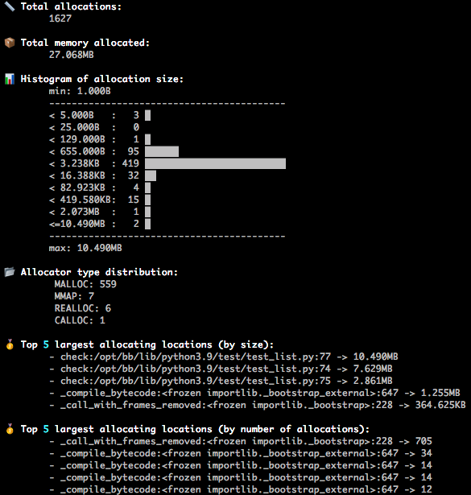

Stats Reporter
==============

The stats reporter generates high level statistics about the tracked process's
memory allocations.

The output includes the following:

* Total number of allocations performed

* Total amount of memory allocated

* Histogram displaying the distribution of allocation sizes. The y-axis data (size) is logarithmic.

* Distribution of allocation types (e.g. *MALLOC*, *CALLOC*, *MMAP*, etc.)

* Stack trace and **size** of the top 'n' largest allocating locations by size (*default: 5*, configurable with the ``-n`` command line param)

* Stack trace and **count** of the top 'n' largest allocating locations by number of allocations (*default: 5*, configurable with the ``-n`` command line param)

* (for JSON output only) Metadata about the tracked process

Basic Usage
-----------

The general form of the ``stats`` subcommand is:

.. code:: shell

    memray stats [options] <results>

The only argument the ``stats`` subcommand requires is the capture file
previously generated using :doc:`the run subcommand <run>`.

The output will be printed directly to the standard output of the terminal.

JSON Output
-----------

If you supply the ``--json`` flag, the ``stats`` subcommand will write its
output to a JSON file, rather than to the terminal. Like other commands that
output to files, the default output file name is based on the name of your
capture file, but it can be overridden with the ``-o`` / ``--output`` option.
By default Memray will refuse to overwrite an existing file, but you can force
it to by supplying the ``-f`` / ``--force`` option.

Note that new fields may be added to the JSON output over time, though we'll
try to avoid removing existing fields.

JSON fields
~~~~~~~~~~~

The top-level object contains:

``total_num_allocations``
    The number of allocations performed. Deallocations are not counted.

``total_bytes_allocated``
    The total number of bytes requested by those allocations.

``allocation_size_histogram``
    A list of bins, each with ``min_bytes``, ``max_bytes`` and ``count``. Both
    bounds are inclusive, and ``count`` is the number of allocations whose size
    falls within the bin.

``allocator_type_distribution``
    The number of allocations performed by each allocator (for example
    ``MALLOC`` or ``PYMALLOC_MALLOC``), sorted from most to least used.

``top_allocations_by_size`` / ``top_allocations_by_count``
    The locations that allocated the most memory, or performed the most
    allocations, as ``function:file:line`` strings with a ``size`` or ``count``.

``top_modules_by_allocation_size`` / ``top_modules_by_allocation_count``
    The same rankings grouped by module, each entry with ``module``,
    ``num_allocations`` and ``total_bytes``.

``metadata``
    Information about the tracked process and the capture file, described below.

The ``metadata`` object contains:

``start_time`` / ``end_time``
    When tracking started and stopped.

``total_allocations``
    The number of allocation records in the capture file. Memray uses the same
    record type for allocations and deallocations, so this counts both, and is
    usually close to twice ``total_num_allocations``. It describes the capture
    file rather than the tracked program.

``total_frames``
    The number of Python frame records in the capture file. This is a
    statistic about Memray's file format, not a count of distinct functions or
    frame objects in the tracked program.

``peak_memory``
    The highest heap memory usage seen while tracking was active, in bytes.
    Heap memory usage at any moment is the total size of all allocations made
    since tracking started that have not yet been freed.

``command_line`` / ``pid`` / ``main_thread_id``
    The command that was tracked, its process ID, and the ID of its main thread.

``python_allocator``
    The Python memory allocator in use (for example ``pymalloc``).

``has_native_traces``
    Whether the capture includes native (C/C++) stack traces, as enabled by
    ``memray run --native``.

``trace_python_allocators``
    Whether allocations made through Python's own allocators were tracked
    individually, as enabled by ``memray run --trace-python-allocators``.

``file_format``
    ``0`` for a capture containing every allocation, or ``1`` for an aggregated
    capture produced by ``memray run --aggregate``.

CLI Reference
-------------

.. argparse::
   :ref: memray.commands.get_argument_parser
   :path: stats
   :prog: memray
